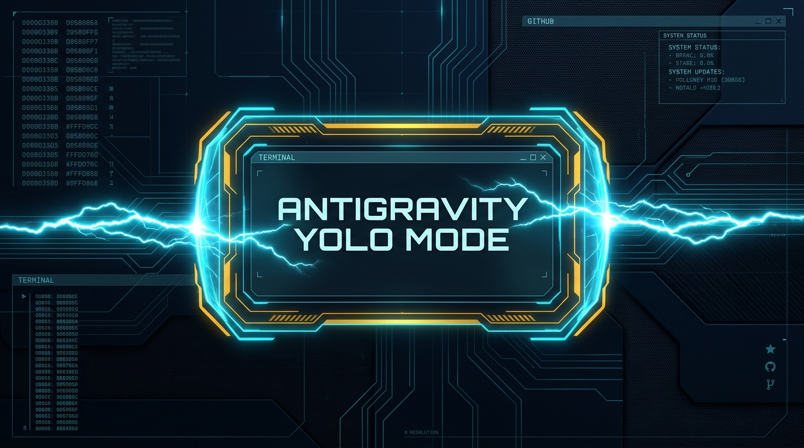
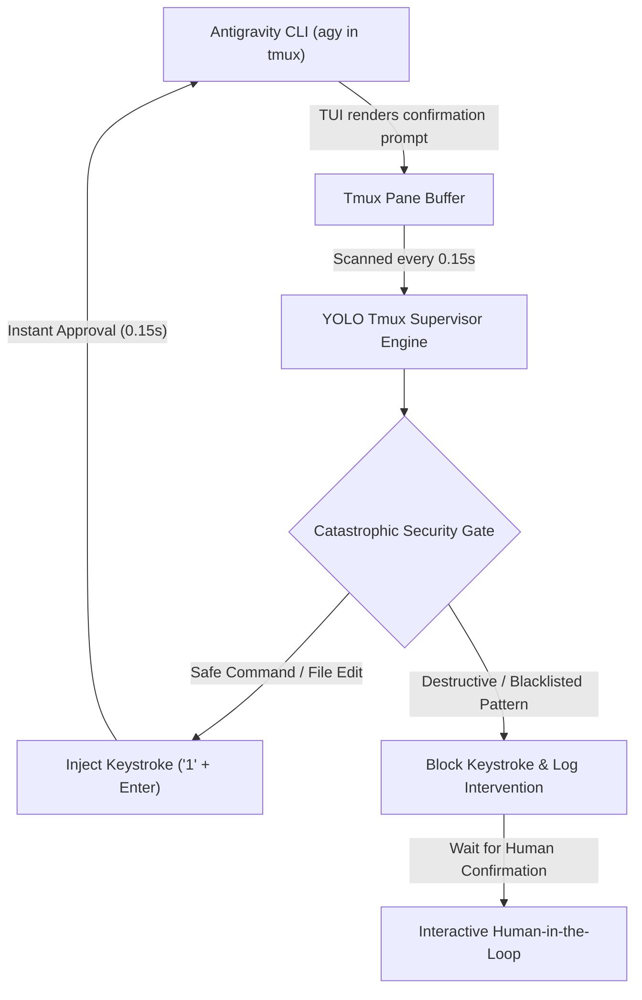

<p align="center">
  
</p>

# Antigravity YOLO Mode (Tmux Autonomous Engine)

<p align="center">
  <strong>Autonomous prompt approver and non-interactive execution harness for Google Antigravity with catastrophic command safety.</strong>
</p>

<p align="center">
  <a href="#quickstart"><strong>Quickstart</strong></a> &middot;
  <a href="#key-features"><strong>Features</strong></a> &middot;
  <a href="#architecture--lifecycle"><strong>Architecture</strong></a> &middot;
  <a href="#security-guardrails--safety-matrix"><strong>Safety Matrix</strong></a> &middot;
  <a href="#configuration--customization"><strong>Configuration</strong></a> &middot;
  <a href="#troubleshooting--health-check"><strong>Troubleshooting</strong></a>
</p>

<p align="center">
  <a href="LICENSE"></a>
  
  
  
  <a href="https://github.com/A7mad-Alone/antigravity-yolo-mode/stargazers"></a>
</p>

<p align="center">
  <a href="https://ko-fi.com/a7madalone" target="_blank">
    
  </a>
</p>

<br/>

> [!NOTE]
> ### ⚡ Autonomous Acceleration with Human-in-the-Loop Safety
> Antigravity YOLO Mode runs directly alongside your `agy` interactive terminal inside `tmux`. It delivers the speed of autonomous looping while preventing accidental destruction of your filesystem, drives, or remote git branches.

---

## Table of Contents

1. [Overview & Why This Exists](#overview--why-this-exists)
2. [Visual Walkthrough](#visual-walkthrough)
3. [Key Features](#key-features)
4. [Architecture & Lifecycle](#architecture--lifecycle)
5. [Ecosystem & Platform Compatibility](#ecosystem--platform-compatibility)
6. [Requirements & Prerequisites](#requirements--prerequisites)
7. [Quickstart & Setup Instructions](#quickstart--setup-instructions)
8. [Usage Guide & Slash Commands](#usage-guide--slash-commands)
9. [Security Guardrails & Safety Matrix](#security-guardrails--safety-matrix)
10. [Configuration & Customization](#configuration--customization)
11. [Troubleshooting & Health Check](#troubleshooting--health-check)
12. [Support, Contributing & License](#support-contributing--license)

---

## Overview & Why This Exists

When running complex coding workflows, Google Antigravity (`agy`) frequently stops to ask for interactive user confirmations:
* *"Run this command?"*
* *"Allow creation/edit of this file?"*
* *"Allow access to this URL?"*

While safe, answering dozens of modal prompts breaks workflow momentum when building entire projects. However, running completely unshielded flags can be risky. 

**Antigravity YOLO Mode** solves this with a **Supervisor Daemon**:
* It hooks into your active `tmux` pane.
* It auto-approves safe prompts in **0.15s**.
* It intercepts and pauses execution if a command is destructive (e.g., recursive root deletions, raw partition writes, or force-pushes).

---

## Visual Walkthrough

```text
[User]         > Refactor authentication handlers and run the test suite
[Antigravity]  ? Run this command: `npm test`? [Y/n]
[YOLO Engine]  ⚡ Auto-Approved via tmux pane #0 (0.14s)
...
[Antigravity]  ? Run this command: `rm -rf /`? [Y/n]
[YOLO Engine]  🛡️ SAFETY INTERVENTION: Blocked auto-approval for catastrophic command.
               [Paused for manual Human confirmation]
```

---

## Key Features

* **⚡ Native Autonomous Approver (`yolo_tmux_engine.py`):**
  Monitors the active Antigravity tmux pane buffer in real time (0.15s polling) and sends instantaneous affirmative keystrokes (`1\n`) directly to the TUI pane.
* **🛡️ Catastrophic Command Guardrails:**
  Hardcoded security regex ensures that destructive operations (e.g., `rm -rf /`, formatting disks, force-pushing remote branches) are never auto-approved.
* **🎯 Scoped Flavors (Session vs. Task Mode):**
  * `session`: Stays active until explicitly turned off via `/yolo off`.
  * `task`: Runs autonomously for the current objective and automatically reverts to guarded mode once the task finishes.
* **🔒 Isolated Per-Tmux-Session State:**
  Enabling YOLO mode in one tmux session does not leave other sessions unguarded.
* **🔄 Zero-Failure Session Auto-Reset:**
  Guaranteed clean state upon exit. Every new Antigravity session **always starts in guarded mode by default**.

---

## Architecture & Lifecycle



1. **State Registry (`~/.gemini/yolo_sessions.json`):** Tracks which tmux sessions currently have autonomous privileges.
2. **Tmux Engine (`scripts/yolo_tmux_engine.py`):** Runs as a lightweight background daemon when at least one session is active.
3. **Control CLI (`scripts/toggle_yolo.py`):** Dispatched via `/yolo` slash command or terminal alias.

---

## Ecosystem & Platform Compatibility

| Ecosystem / Tool | Compatibility | Details |
| :--- | :--- | :--- |
| **Google Antigravity (`agy`)** | Native Full Support | Autonomous keystroke injection & prompt approval |
| **Agensi.io / Claude Code / Cursor** | Skill Compatible | Vendor-neutral `SKILL.md` included for cross-agent workflows |
| **Operating System** | Linux / macOS / WSL2 | Tested on Ubuntu, Debian, Raspberry Pi OS, macOS (tmux 3.0+) |
| **Terminal Multiplexer** | `tmux` | Required for non-invasive background capture |

---

## Requirements & Prerequisites

### Software Dependencies
* **Python 3.10+** (Standard library only; zero pip dependencies required)
* **tmux 3.0+** (`sudo apt install tmux` or `brew install tmux`)
* **Google Antigravity (`agy`)** installed and authenticated

---

## Quickstart & Setup Instructions

### Step 1: Clone Repository
Clone directly into your Antigravity skills directory (or clone into your projects folder and symlink):

```bash
git clone https://github.com/A7mad-Alone/antigravity-yolo-mode.git ~/.gemini/antigravity-cli/skills/yolo-mode
```

### Step 2: Make Scripts Executable
```bash
chmod +x ~/.gemini/antigravity-cli/skills/yolo-mode/scripts/*.py
```

### Step 3: Add Helpful Shell Aliases (Optional)
Add quick toggle commands to your `~/.bashrc` or `~/.zshrc`:

```bash
alias yolo-on="python3 ~/.gemini/antigravity-cli/skills/yolo-mode/scripts/toggle_yolo.py on"
alias yolo-off="python3 ~/.gemini/antigravity-cli/skills/yolo-mode/scripts/toggle_yolo.py off"
alias yolo-status="python3 ~/.gemini/antigravity-cli/skills/yolo-mode/scripts/toggle_yolo.py status"
```

Then reload your environment:
```bash
source ~/.bashrc
```

---

## Usage Guide & Slash Commands

Always run Antigravity inside a `tmux` session to enable pane capture:

```bash
tmux new -s work
agy
```

Inside the Antigravity conversation prompt:

| Command | Action | Description |
| :--- | :--- | :--- |
| `/yolo on` (or `/yolo`) | **Enable Session YOLO** | Runs autonomously until turned off. |
| `/yolo on task` | **Enable Task YOLO** | Runs autonomously for the current task, then automatically disengages. |
| `/yolo off` | **Disengage YOLO** | Restores guarded mode with manual prompts. |
| `/yolo status` | **Inspect State** | Displays whether autonomous mode and supervisor daemon are active. |

---

## Security Guardrails & Safety Matrix

The engine parses the incoming command against strict security patterns before auto-approving:

| Risk Category | Forbidden Pattern (Regex) | Action Taken |
| :--- | :--- | :--- |
| **Root Deletion** | `rm -rf /`, `rm -rf /*` | 🛡️ Auto-approval blocked. Pauses for manual review. |
| **Filesystem Wipe** | `mkfs.*` | 🛡️ Auto-approval blocked. Pauses for manual review. |
| **Fork Bombs** | `:\(\)\s*\{\s*:\|:&\s*\}\s*;` | 🛡️ Auto-approval blocked. Pauses for manual review. |
| **Direct Disk Overwrite** | `> /dev/sd*`, `> /dev/nvme*`, `dd if=/dev/zero ...` | 🛡️ Auto-approval blocked. Pauses for manual review. |
| **Root Permission Escalation** | `chmod -R 777 /`, `chown -R ... /` | 🛡️ Auto-approval blocked. Pauses for manual review. |
| **Destructive Git Actions** | `git push --force`, `git push origin :branch`, `git push --delete` | 🛡️ Auto-approval blocked. Pauses for manual review. |

---

## Configuration & Customization

To add your own custom blocked commands (e.g., blocking `docker system prune` or production database drops), edit `CATASTROPHIC_PATTERNS` in:

[`scripts/yolo_tmux_engine.py`](scripts/yolo_tmux_engine.py):

```python
CATASTROPHIC_PATTERNS = [
    r"\brm\s+-[rf]{1,4}\s+/(?:\s|$|\*)",
    r"\bmkfs\b",
    # Add your custom rules here:
    r"\bdocker\s+system\s+prune\b",
    r"\bdrop\s+database\b",
]
```

Restart the background daemon to apply changes:
```bash
python3 scripts/toggle_yolo.py restart-engine
```

---

## Troubleshooting & Health Check

### 1. Check Real-Time Logs
View live auto-approval and security intervention events:
```bash
tail -f ~/.gemini/yolo_tmux_engine.log
```

### 2. Verify Supervisor Process
```bash
python3 scripts/toggle_yolo.py status
```
If the supervisor daemon shows `⚪ STOPPED` while YOLO mode is ON, trigger a restart:
```bash
python3 scripts/toggle_yolo.py restart-engine
```

### 3. Emergency Reset
To instantly disengage all sessions and stop the supervisor daemon:
```bash
python3 scripts/toggle_yolo.py reset-default
```

---

## Support, Contributing & License

### ☕ Support Independent Engineering
If this tool saves you time or prevents an accidental terminal disaster, consider supporting its development:

<p align="center">
  <a href="https://ko-fi.com/a7madalone" target="_blank">
    
  </a>
</p>

### Contributing
Contributions, bug reports, and pattern suggestions are welcome! Feel free to open an issue or submit a pull request on GitHub.

### Authors & Credits
* **Ahmad Adham** ([@A7mad-Alone](https://github.com/A7mad-Alone)) — Engineering Lead & Creator of Stark's Lab
* **J.A.R.V.I.S.** — Autonomous AI Co-Engineer & Homelab Orchestrator (Stark's Lab Intelligence System)

### License
This project is open-source software licensed under the [MIT License](LICENSE).
